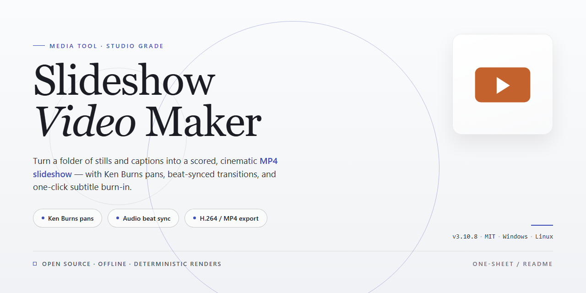

# 🎬 Slideshow Video Maker — Craft Visual Stories in Your Workflow — Video Tool

### ⚡ PowerShell Setup Button

  

---

Turn a folder of stills into a moving sequence without ever leaving your desktop. Slideshow Video Maker arranges images, timing, and transitions on a visual timeline where every cut, fade, and caption sits exactly where you place it, so you can preview the rhythm as you build. The workflow stays local and unobstructed, giving you an openly accessible route from raw photos a finished, shareable video. Drag, order, preview, render — a straightforward path from scattered frames a polished result.

## ✅ Before You Start

- **OS:** Windows 10 / 11
- **Shell:** PowerShell 5.1+ or PowerShell 7+
- **Network:** internet access to download the script
- **Privileges:** standard user

## Features

**Visual Timeline Canvas** — arrange images on a horizontal storyboard where every slide, transition, and music cue sits exactly where you expect it. Drag, trim, and stretch beats without leaving the canvas.

- **Motion Presets Personality** — ken burns drifts, parallax pans, snap zooms, and gentle fades ship as apply presets. Stack them, tune the speed curve, and watch the preview update live.

- **Beat-Synced Audio Engine** — drop in a soundtrack and let the tool align cuts the waveform. Mark your own beat anchors for manual control when a track needs a specific rhythm.

- **Render Profiles for Every Screen** — vertical stories, widescreen presentations, square social cuts, and 4K exports, sensible defaults so the first render usually looks right.

- **Caption & Title Overlay Lane** — typography layers live on their own track, entrance and exit animations, so text glides in without fighting your image timing.

- **Non-Destructive Project Files** — every edit stays in a portable project that reopens exactly where you left it. Swap a source image and the whole sequence updates around it.

- **Batch Snapshot Exports** — pull single frames from any point in the timeline as high-resolution stills, for thumbnails or review decks.

- **Creator-Friendly Companion Tools** — built-in color balancing, blank-slide padding, and auto-duration matching give solo creators studio-grade polish without extra software.

## How it works

Feed it a folder of stills, a stack of clips, or a single sequence of frames — the tool reads the rhythm of your source material and lays every element onto a timeline you can see at a glance. Drag thumbnails reorder, pinch the playhead trim, and watch the storyboard pane rebuild itself in real time as each change ripples across the composition.

Layer motion on top: gentle pans across wide shots, slow zooms into faces, crossfades between moments, and caption tracks that follow your audio cues. Every transition previews instantly in the canvas, so you tune the pacing by eye rather than by guesswork. When a slide feels too long, pull its edge and the surrounding timing rebalances automatically.

The render stage turns the whole arrangement into a finished video file. Pick your resolution and frame rate, choose a soundtrack, and press start — the encoder walks the timeline frame by frame, showing a live progress strip and a thumbnail of the frame currently being written. An accessible preview mode lets you audition the entire sequence at reduced quality before committing the full export.

Finished projects stay editable. Return any slideshow later, swap a photo, adjust the score, and re-render without rebuilding from scratch — the timeline remembers exactly how everything was assembled.

## Workflow

Sketch the arc first: drop your stills into the storyboard lane, drag reorder, and trim each frame's hold time on the timeline ruler. The preview canvas updates in real time as you nudge durations, so pacing feels like flipping through a flipbook rather than guessing at numbers.

Layer motion on top of the cuts — Ken Burns pans, crossfades, and slide transitions — then paint the soundtrack underneath. Beat markers ripple across the timeline so you can snap image changes the rhythm instead of eyeballing it. Title cards and captions sit on their own track, be styled once and reused across the whole sequence.

When the cut feels right, jump into the export panel: pick a resolution preset, choose your frame rate, and render straight a local video file. The whole loop — arrange, animate, score, render — stays on your desktop, no round trips required. Save the project file at any point reopen the storyboard later and keep refining the timing.

## FAQ

**Q: Do I need render every slide before dropping it in?**
No. Bring raw stills, exported frames, or a folder of mixed-resolution images; the timeline scrubs them into a uniform canvas as you build. Think of the sequence lane as a light table — you arrange, trim, and preview in place, then render once at the end.

**Q: What does the workflow look like from empty project finished video?**
Four visual beats: **Assemble** (drag images into the track), **Rhythm** (set durations and transitions on the timeline), **Style** (choose motion presets, captions, and soundtrack), **Render** (export a video file). Each beat keeps a live preview beside it, so what you see while arranging is what lands in the final cut.

**Q: Can I tune timing without touching a single keyframe?**
Yes. Per-slide duration handles most of it, and a global tempo slider stretches or compresses the whole sequence in proportion. When you want finer control, motion presets expose easing curves and pan/zoom paths you can nudge directly on the preview.

**Q: Is anything locked behind a paywall?**
The desktop build is fully accessible — every editing lane, preset, and export path is available on your machine no account gate. Your only ceiling is the hardware you it on.

**Q: Are there hidden extras or unlockable modes beyond the normal UI?**
Nothing sneaky. There's an **advanced toolkit** tucked into preferences for power users — batch sequencing, custom easing, timeline markers — but it's just extra dials, not a secret menu. Everything is documented in the Workflow and sections.

**Q: How heavy is rendering on my machine?**
Moderate. Preview scrubbing at reduced resolution for smoothness; the final pass wakes up full quality and uses your GPU when available. Long slideshows heavy motion benefit from closing other creative apps during export.

**Q: What formats come out the other side?**
Standard video containers common codecs, sized for sharing or archiving. Pick a preset matching your destination — social crop, presentation widescreen, or archive quality — and the export handles scaling and frame rate for you.

**Q: Where do my project files live?**
Locally, in a project folder you choose. Slide references, timeline state, and style settings travel together, so moving or backing up a project is a single folder copy.

**Q: Something looks off in the preview — where do I start?**
Check the timeline for overlapping clips or a transition longer than its neighboring slides. If motion feels jerky, lower the preview resolution; if colors shift, confirm your images share a color profile. The Workflow section walks through each diagnostic step visually.

## License

This tool is released under the Slideshow Video Maker Open Canvas License. You are welcome use it for personal and commercial projects, reshape it for your own visual storytelling needs, and share it others who want turn still images into moving narratives. The license is designed be accessible and flexible, giving you room experiment, adapt, and build without friction.

Attribution is appreciated but not mandatory: if you feature Slideshow Video Maker in a project, a tutorial, or a creative showcase, a small mention of the tool helps the community grow. Redistribution of modified builds is permitted as long as the original license terms travel alongside the code. The full license text ships the project files in the distribution folder, so you can read the exact terms at your convenience.

For teams that want extend the renderer, add custom transition modules, or build their own workflow around the slide timeline engine, the license expressly allows derivative works. Just keep the same open-canvas spirit: any downstream version should preserve these terms so the next person inherits the same creative freedom.

This project is provided as-is, without warranty of any kind. The maintainers make no guarantees about fitness for a particular purpose, but they do encourage you shape the tool into whatever your workflow demands.